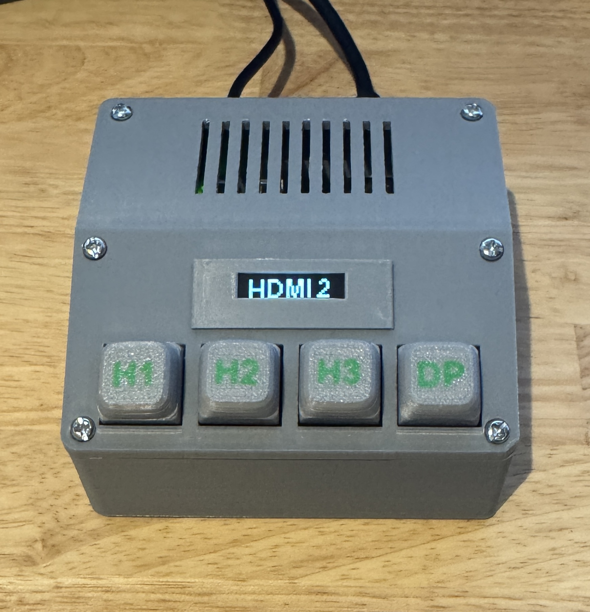
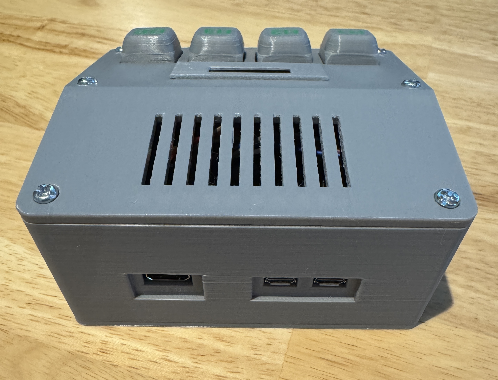

# Step 5 — Print and assemble the enclosure

The [3d folder](../3d/) contains two enclosure designs for the four-key controller and optional OLED from [Step 2](setup-keys.md) and [Step 4](setup-oled.md):

| Design | Pi Zero location | Desktop support |
| --- | --- | --- |
| [v1 — Separate Pi Zero](../3d/v1/) | Outside the key enclosure, connected by wires | Separate 20° cradle |
| [v2 — Combined keys and Pi Zero](../3d/v2/) | Inside the rear of the same enclosure | Built into the lower body |

The folder names identify the two designs. Suffixes such as `v3` and `v7` in filenames identify revisions of individual parts; use the matching files within your chosen folder.

The [g95nc_frame.3mf](../3d/g95nc_frame.3mf) slicer project includes **both v1 and v2**. Select the parts or plates for your chosen version before printing.

## 1. Choose the parts

### v1 — Key enclosure with a separate Pi Zero

This version houses the four keys and OLED. The Pi Zero remains separate, with wiring routed through the rear connector area. The key enclosure sits in a removable desktop cradle.

| File | Purpose |
| --- | --- |
| [lower_frame_m3_v3.stl](../3d/v1/lower_frame_m3_v3.stl) | 100 × 52 × 25 mm lower enclosure, with raised switch seats, two rear six-pin connector holders, and four M3 cover screw positions. |
| [top_cover_m3_v2.stl](../3d/v1/top_cover_m3_v2.stl) | Matching removable cover with four key openings and an OLED opening. |
| [desktop_cradle_20deg_v1.stl](../3d/v1/desktop_cradle_20deg_v1.stl) | Separate cradle with a 110 × 60 mm footprint, holding the key enclosure at 20°. The rear center stays open for connectors. |
| [oled.stl](../3d/v1/oled.stl) | OLED frame model supplied with this design; compare it with your actual display before printing and fitting. |
| [keycaps_A1_AMS_Lite_2color_v2.3mf](../3d/v1/keycaps_A1_AMS_Lite_2color_v2.3mf) | Two-color H1, H2, H3, and DP keycap project prepared for a Bambu A1 with AMS Lite. |

### v2 — Combined key and Pi Zero enclosure

This version combines the lower frame, desktop base, and Pi Zero compartment into one continuous body. The front control face retains its 20° slope; the horizontal rear cover meets the highest point of that slope without a raised step. One removable cover spans both areas, with ventilation slots above the Pi.

The assembled v2 enclosure, viewed from the front:

Rear view showing the Pi Zero's mini HDMI and two micro-USB ports in the recessed openings:

| File | Purpose |
| --- | --- |
| [integrated_lower_body_v7.stl](../3d/v2/integrated_lower_body_v7.stl) | Integrated lower body with raised switch seats, two adjacent floor-level six-pin connector holders, four Pi mounting posts, rear interface openings, and foot recesses. |
| [unified_vented_top_cover_v7.stl](../3d/v2/unified_vented_top_cover_v7.stl) | One-piece cover with four key openings, an OLED opening, rear ventilation slots, and six M3 screw positions. The old underside pin-retaining protrusions are removed. |
| [oled.stl](../3d/v2/oled.stl) | OLED frame model supplied with this design; check the fit against your display. |
| [keycaps_A1_AMS_Lite_2color_v2.3mf](../3d/v2/keycaps_A1_AMS_Lite_2color_v2.3mf) | Two-color keycap project shared with v1. |

The assembled enclosure is approximately **100 × 94.6 × 49.1 mm**. Its internal width is **93.2 mm**. The rear Pi area is open to the front wiring area, without a separate dividing wall.

Key details of the integrated design:

- The Pi Zero W mounts **component side up**, with GPIO toward the keys and mini HDMI, USB data, and USB power facing the rear wall.
- Four **M2.5** posts rise **15 mm above the 3 mm internal floor**. The PCB underside is therefore 18 mm above the outside bottom. Post pilot holes are 2.1 mm in diameter and 7 mm deep, for direct threading into plastic rather than metal inserts.
- Two six-pin holders sit directly on the floor behind the raised key base. They share a central wall and occupy 29.6 mm across; each seat has 12.4 mm clear width, 3.2 mm fore-aft clearance, and an 8 mm retaining height.
- Three separate inner interface windows align with the Pi connectors. The outer plug recesses provide extra clearance for cable housings. The V7 recesses extend a further 2 mm downward compared with V6; the two USB outer recesses join together, while their inner windows remain separate.
- The rear cover has ten 2 × 25 mm ventilation slots. Four bottom recesses, 8.3 mm in diameter and 0.8 mm deep, accept 8 mm adhesive feet.

## 2. Prepare the print

1. Import STL files in **millimetres at 100% scale**. Use the cover from the same design folder as the lower body.
2. Place the lower body and, for v1, the separate cradle flat-bottom-down on the bed.
3. Check cover orientation and supports in the slicer. The v1 cover is supplied with its exterior face down. The v2 cover is supplied with its rear exterior face down; its sloping front section needs support review. Inspect bridges, openings, and internal overhangs before printing.
4. For the keycap 3MF, keep the body and lettering parts aligned. Check the printer, build plate, filament, and color assignments before slicing; adapt the saved profile if your printer differs from the named A1/AMS Lite setup.
5. Remove support material and clear screw holes and connector seats before fitting electronics. Do not force a switch, header, or screw into an undersized printed feature.

STL geometry does not specify a universal material, layer height, or support configuration. Use settings appropriate to your printer and inspect the sliced layers, particularly around the tilted cover and connector openings.

## 3. Assemble the chosen design

Shut down the Pi and disconnect power and HDMI/USB cables before installing or adjusting wiring. Follow the electrical connections in [Step 2](setup-keys.md) and [Step 4](setup-oled.md); connector-holder positions do not define an electrical pinout.

### Assemble v1

1. Fit the four switches into the raised seats and install the keycaps in H1, H2, H3, DP order.
2. Fit the OLED behind its cover opening, checking clearance and alignment with the actual module and supplied frame model.
3. Route the key and display leads through the internal guides and rear connector area to the separate Pi Zero. Insulate exposed joints and leave enough slack to remove the cover.
4. Fit the matching cover using four M3 screws. The original cover design uses M3 × 10 mm screws; tighten gently into the plastic pilot holes.
5. Add four 8 mm adhesive feet to the cradle recesses, using pads thicker than the 0.8 mm recess depth. Place the enclosure in the cradle and check that rear plugs remain accessible.

### Assemble v2

1. Fit the switches, keycaps, and OLED, then prepare the wiring before closing the enclosure.
2. Fit the two six-pin headers into the adjacent floor-level holders. Route their wires through the open floor area, keeping them away from screw posts and mounting surfaces.
3. Mount the Pi component side up on the four M2.5 posts. Select screw length for your actual PCB and washers: the plastic pilot holes are only 7 mm deep. Tighten gently without bending the board or bottoming out the screws.
4. Test mini HDMI, USB data, and USB power with the actual cables. Check that each plug seats fully and that all three can be connected simultaneously without their housings catching the outer recesses.
5. Arrange the wiring so it does not pull on GPIO connections or become trapped beneath the Pi or cover. Keep ventilation slots clear.
6. Fit the unified cover using six M3 screws. Check the engagement at each position before tightening; the four front screws follow the inclined face, while the two rear screws are vertical.
7. Fit four 8 mm adhesive feet, thicker than 0.8 mm, into the bottom recesses.

## 4. Check fit and operation

The v2 model was checked for closed printable meshes and interference between the cover, PCB, GPIO wiring envelope, and connector envelopes. These are geometric checks, not proof that every display, header, cable housing, or printer tolerance will fit.

For v2, the PCB top has approximately **26.3 mm** to the rear cover underside. A GPIO connection extending 17 mm above the PCB leaves about **9.3 mm**. The provisional 13 × 20 × 10 mm plug envelopes at the floor-level headers leave **4.2 mm** below the Pi PCB. Check your actual connectors and cable bends against those allowances.

Before final tightening, verify that:

- All four keys move freely and return without rubbing the cover.
- The OLED is aligned and its connections are insulated.
- The cover closes without pressing on wires, components, or connectors.
- Pi connectors seat fully, mounting screws hold securely, and no screw tip reaches the PCB or wiring.
- The enclosure rests securely on its feet, and the rear ventilation slots remain open.

Reconnect the system and repeat the key/input-switching checks from [Step 3](setup-controller.md), then verify the OLED as described in [Step 4](setup-oled.md).
