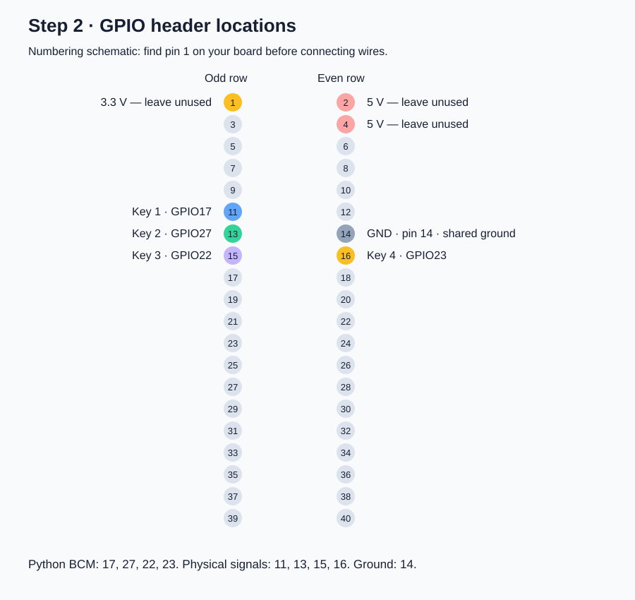
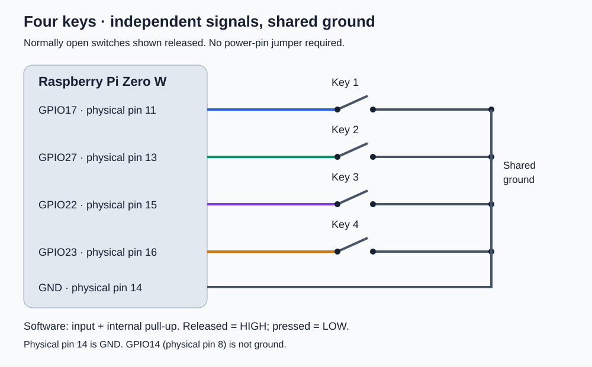

# Step 2 — Setup Keys: connect push buttons to GPIO

This step adds physical keys to the **original Raspberry Pi Zero W** used in [Step 1: Pi and monitor setup](setup-guide.md). Here, a key means a passive, normally open momentary push button or keyboard switch with two electrical contacts. This is a four-key layout; start with Key 1 and repeat for additional keys. A USB keyboard, powered key module, illuminated switch, or scanned keyboard matrix needs different wiring.

The GPIO test below only prints key presses. It does not change the monitor input or install a background controller. Continue with [Step 3](setup-controller.md) to assign verified input values and install the background controller.

## 1. Parts and safe preparation

- Raspberry Pi Zero W with a securely soldered 2 × 20 GPIO header. Many Zero W boards have empty header holes; loose wires pushed into holes are not reliable connections. The Zero WH has a fitted header.
- Four normally open momentary switches.
- Breadboard and suitable jumper wires, or insulated soldered switch leads. Female jumper ends fit the Pi header.
- Multimeter with continuity mode for identifying switch contacts and checking wiring.

Shut down the Pi with `sudo poweroff`, wait for shutdown, then disconnect power and any HDMI/USB cables before wiring. Reconnect only after checking the circuit. Keep exposed connections from touching adjacent pins.

**GPIO uses 3.3 V logic and is not 5 V tolerant. This circuit needs no connection to the 5 V or 3.3 V power pins.** Each key connects its assigned GPIO input to ground when pressed. Configure the GPIO as an input with an internal pull-up before testing; do not drive these pins as outputs while a switch can short them to ground.

## 2. Pin numbers and the proposed key layout

**Physical pin** means the position on the 40-pin header. **BCM/GPIO number** is the number used by GPIO Zero in Python. These are different numbering systems. **Physical pin 14 is GND; GPIO14 is physical pin 8 and is not ground.**

| Key | Python BCM number | Physical header pin | Other switch contact | Suggested later action |
| --- | --- | --- | --- | --- |
| Key 1 | GPIO17 (`17`) | **11** | GND, physical **14** | Select first verified input |
| Key 2 | GPIO27 (`27`) | **13** | Same GND connection | Select second verified input |
| Key 3 | GPIO22 (`22`) | **15** | Same GND connection | Select third verified input |
| Key 4 | GPIO23 (`23`) | **16** | Same GND connection | Select fourth verified input |

The keys share ground; **their signal wires stay separate**. Use a breadboard rail or insulated junction to split the wire from pin 14 to all four switches. Do not force four jumper connectors onto one header pin. Leave GPIO2/3 free; those are the usual GPIO I2C pins, and the HDMI DDC connection is separate from these key wires.

### Header location diagram



This is a **numbering diagram, not a photograph or board orientation guide**. Locate physical pin 1 using the board's pin-1 marking/square pad and the official pinout. View from the component/header side, not the solder side; rotating the board does not change pin numbering. Odd-numbered pins run 1–39 in one row; even-numbered pins run 2–40 in the other. Confirm the position before attaching a lead. Where available, running `pinout` on the Pi provides a board diagram.

## 3. Understand the electrical connection



For each key, connect **one electrical contact to its GPIO and the other to GND**. The software enables an internal pull-up resistor: released = electrical HIGH, pressed = electrical LOW. GPIO Zero reports `is_pressed = True` for the pressed state, despite the electrical level being LOW. No external pull-up is needed for this short-wire prototype.

```text
Inside Pi                 Outside Pi
3.3 V ── internal pull-up ──┬── GPIO17 / physical 11
                           │
                           └── normally open Key 1 ── GND / physical 14

Released: switch open, pull-up holds GPIO HIGH.
Pressed:  switch closes, GPIO connects to GND and becomes LOW.
```

The 3.3 V connection above is **inside the Pi**; do not add a jumper to physical pin 1. Use short wires for the initial test. Longer cables may need stronger external pull-ups, filtering and protection appropriate to their environment.

### Two-terminal and four-leg switches

A two-terminal mechanical keyboard switch has one contact on each terminal: use both. Plastic mounting posts are not terminals. If the switch includes an LED, its LED terminals are a separate circuit; leave them disconnected for this step.

A common four-leg tactile switch has **two internally connected pairs**, not four independent contacts. Identify the pairs with continuity mode while the switch is disconnected:

```text
Example electrical grouping — verify YOUR switch with a meter

A1 ●────────● A2       A1/A2 are one contact (always connected)
         │
     press-to-close     Pressing connects contact A to contact B
         │
B1 ●────────● B2       B1/B2 are the other contact (always connected)

Use one A terminal for GPIO and one B terminal for GND.
```

This sketch shows electrical grouping, not a universal physical leg layout. Unpressed, your chosen two terminals must show no continuity; pressed, they must show continuity. Choosing two legs from the same pair makes the key appear permanently pressed. For breadboards, place the switch so its two contact groups occupy separate connected strips; check the breadboard's actual strip layout instead of relying on appearance.

## 4. Wire one key, then add the others

1. With all cables unplugged, find physical pins **14 (GND)** and **11 (GPIO17)**.
2. Connect pin 14 to a breadboard ground rail or insulated ground junction. If a rail is split in the middle, bridge the split or use just one continuous section.
3. Connect one contact of Key 1 to that ground connection.
4. Connect the other contact of Key 1 to physical pin 11.
5. With the Pi still disconnected, confirm the switch itself opens when released and closes when pressed. Inspect for accidental adjacent-pin contact. Do not use continuity mode on powered electronics.
6. Reconnect HDMI and power, start the Pi, and run the test below. Confirm Key 1 before expanding the circuit.
7. Shut down and unplug again. Add Key 2 between physical pin **13** and the ground junction, Key 3 between physical pin **15** and the ground junction, and Key 4 between physical pin **16** and the ground junction.
8. Check the wiring and repeat the test with all connected keys.

## 5. Test key detection on the Pi

Run these commands **on the Pi**, locally or through SSH. Install the packaged library:

```bash
sudo apt update
sudo apt install -y python3-gpiozero
nano ~/test_keys.py
```

Paste this test and save it. If testing just Key 1, reduce `KEY_PINS` to `{"Key 1": 17}`.

```python
from functools import partial
from signal import pause
from gpiozero import Button

KEY_PINS = {"Key 1": 17, "Key 2": 27, "Key 3": 22, "Key 4": 23}
buttons = []


def report(name, state):
    print(f"{name}: {state}", flush=True)


try:
    for name, pin in KEY_PINS.items():
        button = Button(pin, pull_up=True, bounce_time=0.05)
        button.when_pressed = partial(report, name, "pressed")
        button.when_released = partial(report, name, "released")
        buttons.append(button)
        report(name, "pressed" if button.is_pressed else "released")
    print("Ready. Press each key. Ctrl+C stops the test.", flush=True)
    pause()
except KeyboardInterrupt:
    pass
finally:
    for button in buttons:
        button.close()
```

Run:

```bash
python3 ~/test_keys.py
```

Expect an initial `released` line for each unpressed key, followed by the correct key name on press and release. The `0.05` setting applies 50 ms of software debounce to reduce duplicate events from switch bounce; adjust only if testing shows missed presses or extra events. No GPIO I2C setting is required for ordinary button inputs.

If access is denied, check `id` and `ls -l /dev/gpiomem`. On Raspberry Pi OS, if that device grants access to the `gpio` group, add your login account with `sudo usermod -aG gpio "$USER"`, then fully log out and back in. If the device/backend differs, investigate the installed GPIO Zero backend rather than changing device permissions broadly. Stop any other program using these same GPIO pins.

## 6. Troubleshooting and completion

| Symptom | Check |
| --- | --- |
| Key always pressed | Same-pair legs selected on a four-leg switch; shorted signal to GND; wrong breadboard strip. |
| Key never changes | Wrong physical pin; loose header joint; ground rail split; switch contacts chosen incorrectly. |
| Wrong key prints | Signal leads swapped; BCM numbers confused with physical pin numbers. |
| Multiple keys respond together | GPIO signal wires joined accidentally. Only ground should be shared. |
| Duplicate or intermittent events | Loose wires, switch bounce, long cables or interference; shorten wires and recheck connections. |
| Pi resets or becomes hot | Disconnect power immediately and inspect for power-to-ground shorts or wrong header placement. |

- [ ] Pin 1 and the header numbering are positively identified.
- [ ] Each key uses two contacts that connect only when pressed.
- [ ] Only physical pins 11, 13, 14, 15 and 16 are used for this proposed layout.
- [ ] Each key reports the correct press and release independently.
- [ ] Test stops cleanly with Ctrl+C; wiring is insulated and secured.

The wiring and example follow the references below, but have not been physically tested on your board. Passing this step verifies the keys; monitor switching still needs the controller behavior and verified DDC input values from Step 1.

## References

- [Raspberry Pi hardware documentation: GPIO and pinout](https://www.raspberrypi.com/documentation/computers/raspberry-pi.html#gpio)
- [GPIO Zero Button API: pull-ups and debounce](https://gpiozero.readthedocs.io/en/stable/api_input.html#button)
- [Raspberry Pi Zero WH: fitted header](https://magazine.raspberrypi.com/articles/new-pi-zero-wh-launched)

